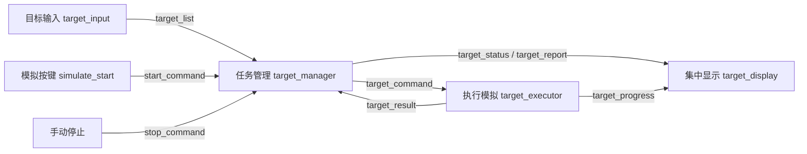

# 第四次任务：ROS2 目标选择与任务执行仿真

本工程完成考核文件中的 **ROS 与系统协同方向**。不需要实车、摄像头或电机。
第三次任务入口 `car_task.launch.py` 仍可运行，第四次任务使用 `fourth_task.launch.py`。

## 一键运行

在终端执行：

```bash
cd ~/下载/ros2_ws
source /opt/ros/jazzy/setup.bash
colcon build --packages-select car_task
source install/setup.bash
ros2 launch car_task fourth_task.launch.py
```

自动模拟一次按键，约 18 秒处理结束；节点保持在线等待，按 Ctrl+C 退出。
默认终端会显示以下过程：

```text
收到乱序目标：T3、T2、T4、T1
按分值排序：T1(9) → T4(6) → T2(5) → T3(1)
T1 移动、抓取 → 成功 → 从待执行列表移除
T4 移动、抓取 → 成功
T2 第一次抓取 → 失败 → 重试一次 → 成功
T3 移动、抓取 → 成功
COMPLETED：当前目标为空，待执行列表为空，成功 4 个
```

## 目标与规则

输入位于 [config/fourth_targets.json](config/fourth_targets.json)。位置单位为米，仅作为模拟目标信息，动作时长固定，不计算真实运动轨迹。

| 编号 | 类别 | 分值 | 位置 (x, y) | 默认执行顺序 |
| --- | --- | --- | --- | --- |
| T1 | 车 | 9 | (1.6, 0.3) | 1 |
| T4 | 炮 | 6 | (0.8, 1.1) | 2 |
| T2 | 马 | 5 | (1.2, 0.7) | 3；首次失败后重试 |
| T3 | 兵 | 1 | (0.5, 0.8) | 4 |

分值为自定义演示规则。优先取分值最高的目标，同分按字符串编号升序。
每次只下发一个目标，必须收到匹配反馈后才安排下一次执行。
成功目标移入 `completed`，不会再次执行；失败允许重试一次，仍失败则移入 `failed` 并继续。
重试是对失败动作的有意再次尝试，使用新的指令编号；重复消息和已成功目标不会触发新的执行。

目标输入采用 JSON 数组，每个目标包含字符串 `id`、`category` 和有限数值 `score`、`x`、`y`。
拒绝重复编号及不合法数据；只在 IDLE 状态接受整批替换，启动后固定本轮目标。
可通过 `target_file:=/绝对路径/targets.json` 使用自己的文件，数量不限于四个。

## 节点通信与状态



状态为 `IDLE → RUNNING → COMPLETED`，中途停止或反馈超时进入 `STOPPED`。
单个目标执行过程中展示移动、抓取及 0%—100% 进度。
结束后只发布一次报告，并保持终态，不自动重新启动；再次演示需重启 launch。

| 话题 | 消息类型 | 内容 |
| --- | --- | --- |
| `/target_list` | String（JSON 数组） | 整批目标输入 |
| `/start_command` | Bool | true 模拟按一次启动键 |
| `/target_command` | String（JSON 对象） | execute/cancel、目标、尝试次数、唯一指令编号 |
| `/target_result` | String（JSON 对象） | 目标编号、指令编号、success/failure、说明 |
| `/target_progress` | String（JSON 对象） | 当前指令、目标、动作阶段和百分比 |
| `/target_status` | String（JSON 对象） | 状态、当前目标、待执行、成功、失败、取消、尝试历史 |
| `/target_report` | String（JSON 对象） | 本轮唯一最终报告 |
| `/stop_command` | Bool | true 请求停止本轮 |

输入、状态、报告采用可靠传输及 transient_local QoS，晚启动的订阅者也能看到最新快照。
执行反馈必须同时匹配 `target_id` 和 `command_id`。指令编号含本轮唯一标识和尝试次数，旧轮次、旧尝试和重复反馈不能推进队列。
执行节点对指令去重，忙碌时拒绝并行执行。管理节点等待执行话题连接后才开始派发。

## 异常演示

每种场景应先 Ctrl+C 结束上一轮。默认场景已经满足“失败并处理”的考核要求。

**持续失败后跳过：**

```bash
ros2 launch car_task fourth_task.launch.py fail_always_ids:=T2
```

T2 连续失败两次后跳过，继续执行 T3；最终成功 3 个、失败 1 个。
`COMPLETED` 表示队列已处理结束，是否全部成功需查看报告中的 `failed`。

**反馈超时：**

```bash
ros2 launch car_task fourth_task.launch.py silent_ids:=T1 result_timeout:=5.0
```

T1 模拟执行后不返回结果，5 秒后管理器取消当前指令并停止整轮。
理由：无法确定执行结果时，继续下发可能造成状态混乱，因而超时后不自动重试或继续。
未完成的目标保留在 `pending`，当前目标记入 `cancelled`，不计为成功。

**手动启动和中途停止：**

终端一：

```bash
ros2 launch car_task fourth_task.launch.py auto_start:=false
```

终端二先加载相同环境，再依次执行（看到第一个目标开始后发停止）：

```bash
source /opt/ros/jazzy/setup.bash
source ~/下载/ros2_ws/install/setup.bash
ros2 topic pub --once /start_command std_msgs/msg/Bool '{data: true}'
ros2 topic pub --once /stop_command std_msgs/msg/Bool '{data: true}'
```

停止命令会取消当前模拟动作，不再派发后续目标。这里的停止仅指软件模拟，不涉及真实电机。

## 观察与验证

另一个加载环境的终端可以运行：

```bash
ros2 node list
ros2 topic list
ros2 topic echo /target_status --qos-durability transient_local
ros2 topic echo /target_report --qos-durability transient_local --once
```

纯 Python 业务测试及 ROS 构建测试：

```bash
cd ~/下载/ros2_ws/src/car_task
python3 -m pytest test/test_target_model.py test/test_task_model.py -q
cd ~/下载/ros2_ws
colcon test --packages-select car_task
colcon test-result --verbose
```

真实节点通信验证（自动使用独立 ROS 域 121—124，不需要另开 launch）：

```bash
cd ~/下载/ros2_ws/src/car_task
python3 test/check_fourth_ros.py
```

检查失败重试成功、持续失败跳过、反馈超时、停止四种场景，额外注入重复指令及错误反馈，核验串行调度、最终结果和结束后不重复执行。
结果保存到 `artifacts/fourth/`，含 launch 日志、真实话题事件 JSONL 和最终报告 JSON。
